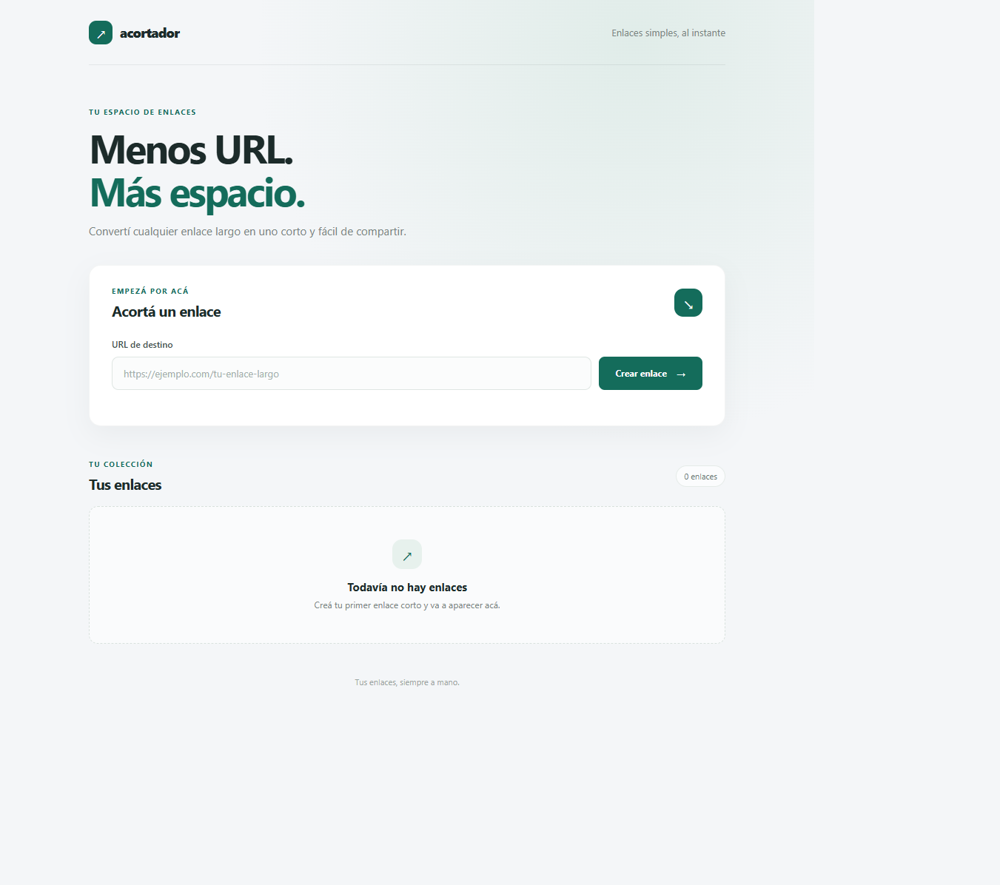
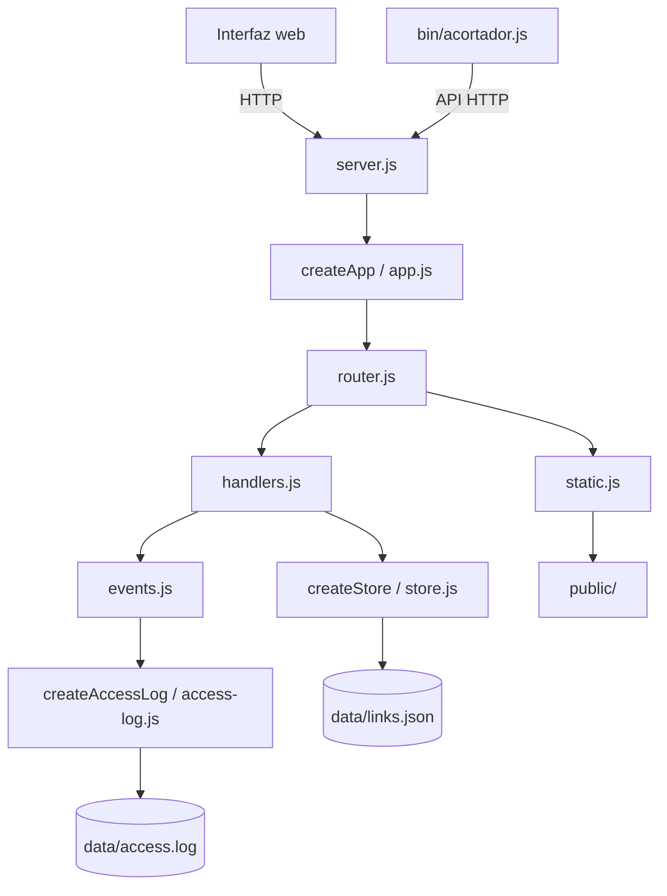

# Acortador de URLs

[](https://github.com/errecart/acortador-URLs/actions/workflows/test.yml)
[English](README.md)

Un acortador de URLs autoalojado y pequeño, con interfaz web, API JSON y cliente de línea de comandos. Tiene **cero dependencias de terceros en tiempo de ejecución**: el servidor, la persistencia, el cliente HTTP y el CLI usan módulos incluidos en Node.js, para simplificar la instalación y reducir la superficie de dependencias.

## Interfaz web



## Inicio rápido

Requisito: **Node.js 22 o posterior**. No hace falta instalar paquetes.

1. Copiá `.env.example` a `.env` (en PowerShell: `Copy-Item .env.example .env`; en macOS/Linux: `cp .env.example .env`).
2. Iniciá el servidor de desarrollo:

   ```sh
   npm run dev
   ```

3. Abrí <http://localhost:3000/>.

El servidor guarda los enlaces en `data/links.json` y los eventos de acceso en `data/access.log`. `npm start` inicia el servidor sin modo watch. Para usar el modelo de permisos de archivos de Node, ejecutá `npm run start:secure`; ver [Seguridad](#seguridad).

### Configuración

| Variable | Valor predeterminado | Propósito |
| --- | --- | --- |
| `PORT` | `3000` | Puerto HTTP donde escucha el servidor |
| `API_URL` | `http://localhost:3000` | URL pública base para construir enlaces cortos; tiene prioridad sobre `BASE_URL` |
| `BASE_URL` | `http://localhost:3000` | URL pública base alternativa y hostname usado para rechazar enlaces al mismo servicio |
| `DATA_DIR` | `./data` | Directorio para `links.json` y `access.log` |
| `REQUEST_TIMEOUT_MS` | `300000` | Duración máxima de una solicitud |
| `HEADERS_TIMEOUT_MS` | `60000` | Tiempo máximo para recibir los headers; no puede superar `REQUEST_TIMEOUT_MS` |
| `KEEP_ALIVE_TIMEOUT_MS` | `5000` | Timeout de sockets keep-alive |

Podés ajustar las variables del archivo de ejemplo para el desarrollo local. Configurá `API_URL`/`BASE_URL` con el origen desde donde se servirán los enlaces cortos.

## CLI

Ejecutá el CLI directamente con Node o instalá el paquete localmente si querés usar el ejecutable `acortador-urls`:

```sh
node bin/acortador.js create https://example.com/una-pagina-larga
# http://localhost:3000/<código>

node bin/acortador.js list
# CÓDIGO   VISITAS  URL
# ...      ...      ...

node bin/acortador.js stats <código>
node bin/acortador.js delete <código> --yes
```

`delete` pide confirmación en una terminal interactiva; `--yes` omite la pregunta. Usá `list --json` para obtener una respuesta procesable por otras herramientas. Por defecto, el CLI se conecta a `http://localhost:3000`; se puede cambiar con `--api <URL>`, `API_URL` o `BASE_URL` (en ese orden de prioridad).

### Demo del CLI

```text
$ node bin/acortador.js create https://example.com/una-pagina-larga
http://localhost:3000/abc1234

$ node bin/acortador.js list
CÓDIGO   VISITAS  URL
...
abc1234  0        https://example.com/una-pagina-larga

$ node bin/acortador.js stats abc1234
Código: abc1234
URL: https://example.com/una-pagina-larga
Visitas: 0
Creado: 2026-10-23T12:00:00.000Z
Última visita: -
```

Los valores del ejemplo ilustran el formato de salida.

## Referencia de la API

Todas las respuestas de error son objetos JSON con una propiedad `error`. Los mensajes visibles del servidor, el CLI y la interfaz web están en español; los identificadores de protocolo y los nombres de las propiedades JSON se mantienen sin traducir.

| Método | Ruta | Éxito | Otros estados relevantes |
| --- | --- | --- | --- |
| `GET` | `/health` | `200` | `405` (`Allow: GET`) |
| `GET` | `/api/links` | `200` — lista de enlaces | `405` (`Allow: GET, POST`) |
| `POST` | `/api/links` | `201` — enlace creado y `shortUrl` | `400` URL o JSON inválido; `413` body mayor a 10 KiB; `405` |
| `GET` | `/:code` | `302` redirección | `404` código desconocido; `405` (`Allow: GET`) |
| `GET` | `/api/links/:code/stats` | `200` — estadísticas del enlace | `404` código desconocido; `405` (`Allow: GET`) |
| `DELETE` | `/api/links/:code` | `204` | `404` código desconocido; `405` (`Allow: DELETE`) |
| `GET` | `/` y recursos públicos | `200` | `400` ruta mal formada o con byte nulo; `404` recurso inexistente; `405` |

Creá un enlace enviando JSON:

```sh
curl -X POST http://localhost:3000/api/links \
  -H "content-type: application/json" \
  -d '{"url":"https://example.com/una-pagina-larga"}'
```

El destino debe ser una URL HTTP o HTTPS de hasta 2048 caracteres, sin credenciales embebidas, y no debe pertenecer al hostname configurado para el servicio. El body JSON está limitado a 10 KiB. La respuesta exitosa incluye `code`, `url`, `createdAt`, `visits`, `lastVisitedAt` y `shortUrl`.

## Diagrama de módulos



`createApp()` devuelve un servidor HTTP sin empezar a escuchar. `src/server.js` se ocupa del inicio, la escucha, el cierre ordenado, la inicialización del store y el ciclo de vida del access log.

## Decisiones y trade-offs

- **302 en vez de 301:** la redirección es temporal para reducir la posibilidad de que navegadores o intermediarios guarden el destino permanentemente en caché.
- **Escrituras atómicas y cola:** las altas y bajas se serializan; se escribe un archivo temporal y luego se renombra a `links.json`. Así se evitan JSON escritos parcialmente y conflictos entre escrituras concurrentes.
- **Persistencia diferida de visitas:** las visitas se guardan aproximadamente una vez por segundo para agrupar escrituras. Un `kill -9` puede perder hasta alrededor de un segundo de visitas que todavía no se hayan persistido.
- **Cuerpos demasiado grandes:** el servidor drena los bytes restantes sin almacenarlos y responde `413` con `Connection: close`. Esto evita acumular el resto del body después de rechazarlo e impide reutilizar esa conexión.
- **Destinos repetidos:** enviar dos veces la misma URL crea dos códigos cortos independientes; no se deduplican.
- **Chequeo del dominio propio:** se rechazan destinos cuyo hostname coincide con el de la URL base configurada. Solo se compara el hostname, no el esquema ni el puerto.
- **Access log:** `data/access.log` es un archivo JSON Lines al que se agregan eventos; actualmente no tiene rotación ni política de retención y puede crecer sin límite.
- **Symlinks en `public/`:** la validación de traversal mantiene las rutas solicitadas dentro de `public/` a nivel léxico, pero las lecturas del sistema de archivos siguen los symlinks. No pongas allí symlinks que no sean confiables: podrían apuntar fuera del directorio de recursos estáticos.

## Seguridad

- Las solicitudes tienen límites configurables mediante `REQUEST_TIMEOUT_MS`, `HEADERS_TIMEOUT_MS` y `KEEP_ALIVE_TIMEOUT_MS` (ver `.env.example`).
- Los bodies JSON tienen un máximo de 10 KiB. Las URLs de destino admiten hasta 2048 caracteres, solo HTTP(S), y se rechazan si incluyen usuario o contraseña.
- Las respuestas incluyen Content Security Policy (`default-src 'self'`), `X-Content-Type-Options`, `Referrer-Policy` y `X-Frame-Options: DENY`.
- Las rutas de recursos estáticos se validan contra traversal y bytes nulos.
- `npm run start:secure` inicia Node con el modelo de permisos de filesystem. Permite leer la aplicación, los recursos públicos, `.env` y `data/`, y escribir solo dentro de `data/`. Crea `data/` antes de iniciar. Si cambia `DATA_DIR`, también hay que actualizar las rutas de permisos en `scripts/start-secure.js`.
- La aplicación está pensada para uso autoalojado y de confianza; agregá autenticación y controles operativos antes de exponer la administración de enlaces a usuarios no confiables.

## Tests

Ejecutá toda la suite de tests incluida en Node.js:

```sh
npm test
```

Los tests usan `node:test` y cubren la API, límites y timeouts de solicitudes, el CLI, traversal de rutas estáticas, persistencia y rollback del store, el access log y errores de inicio. No hacen falta dependencias externas de test.

Para generar el informe de cobertura integrado en Node:

```sh
npm run test:coverage
```

## Próximos pasos

- Evaluar reemplazar el store JSON por `node:sqlite` para tener actualizaciones transaccionales y consultas más eficientes cuando crezca la cantidad de enlaces.
- Agregar rotación y retención al access log.
- Revisar el tratamiento de symlinks y sumar autenticación y rate limiting para instalaciones expuestas a Internet.
