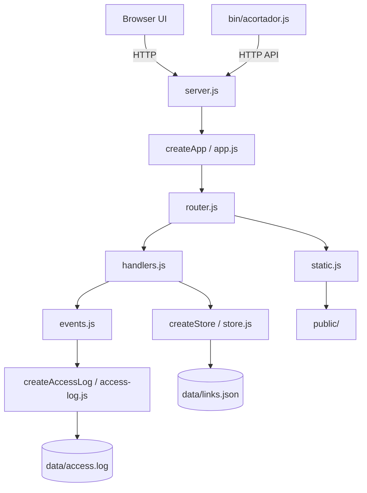

# URL Shortener

[](https://github.com/errecart/acortador-URLs/actions/workflows/test.yml)
[Español](README.es.md)

A small, self-hosted URL shortener with a browser UI, JSON API, and command-line client. It has **zero third-party runtime dependencies**: the server, persistence, HTTP client, and CLI use Node.js built-ins, keeping installation simple and the dependency surface small.

## UI


## Quick start

Requirements: **Node.js 22 or newer**. No package installation is required.

1. Copy `.env.example` to `.env` (for PowerShell: `Copy-Item .env.example .env`; for macOS/Linux: `cp .env.example .env`).
2. Start the development server:

   ```sh
   npm run dev
   ```

3. Open <http://localhost:3000/>.

The server stores links in `data/links.json` and access events in `data/access.log`. `npm start` starts the server without watch mode. For Node's filesystem permission model, use `npm run start:secure`; see [Security](#security).

### Configuration

| Variable | Default | Purpose |
| --- | --- | --- |
| `PORT` | `3000` | HTTP listening port |
| `API_URL` | `http://localhost:3000` | Public base URL used to build short links; takes precedence over `BASE_URL` |
| `BASE_URL` | `http://localhost:3000` | Fallback public base URL and hostname used to reject self-links |
| `DATA_DIR` | `./data` | Directory for `links.json` and `access.log` |
| `REQUEST_TIMEOUT_MS` | `300000` | Maximum request duration |
| `HEADERS_TIMEOUT_MS` | `60000` | Maximum time allowed to receive request headers; cannot exceed `REQUEST_TIMEOUT_MS` |
| `KEEP_ALIVE_TIMEOUT_MS` | `5000` | Keep-alive socket timeout |

The example environment file can be adjusted for local development. Keep `API_URL`/`BASE_URL` pointed at the origin from which short links will be served.

## CLI

Run the CLI directly with Node, or install the package locally if you want the `acortador-urls` executable:

```sh
node bin/acortador.js create https://example.com/a-long-page
# http://localhost:3000/<code>

node bin/acortador.js list
# CÓDIGO   VISITAS  URL
# ...      ...      ...

node bin/acortador.js stats <code>
node bin/acortador.js delete <code> --yes
```

`delete` asks for confirmation in an interactive terminal; `--yes` skips the prompt. Use `list --json` for machine-readable output. By default, the CLI connects to `http://localhost:3000`; override it with `--api <URL>`, `API_URL`, or `BASE_URL` (in that precedence order).

### CLI demo

```text
$ node bin/acortador.js create https://example.com/a-long-page
http://localhost:3000/abc1234

$ node bin/acortador.js list
CÓDIGO   VISITAS  URL
...
abc1234  0        https://example.com/a-long-page

$ node bin/acortador.js stats abc1234
Código: abc1234
URL: https://example.com/a-long-page
Visitas: 0
Creado: 2026-10-23T12:00:00.000Z
Última visita: -
```

The sample values above illustrate the output format.

## API reference

All error responses are JSON objects with an `error` field. Human-readable server, CLI, and UI messages are in Spanish; protocol identifiers and JSON property names remain unchanged.

| Method | Path | Success | Other relevant statuses |
| --- | --- | --- | --- |
| `GET` | `/health` | `200` | `405` (`Allow: GET`) |
| `GET` | `/api/links` | `200` — array of links | `405` (`Allow: GET, POST`) |
| `POST` | `/api/links` | `201` — created link and `shortUrl` | `400` invalid URL or JSON; `413` body over 10 KiB; `405` |
| `GET` | `/:code` | `302` redirect | `404` unknown code; `405` (`Allow: GET`) |
| `GET` | `/api/links/:code/stats` | `200` — link statistics | `404` unknown code; `405` (`Allow: GET`) |
| `DELETE` | `/api/links/:code` | `204` | `404` unknown code; `405` (`Allow: DELETE`) |
| `GET` | `/` and public assets | `200` | `400` malformed or null-byte path; `404` missing asset; `405` |

Create a link with JSON:

```sh
curl -X POST http://localhost:3000/api/links \
  -H "content-type: application/json" \
  -d '{"url":"https://example.com/a-long-page"}'
```

The destination must be an HTTP or HTTPS URL, no longer than 2048 characters, without embedded credentials, and not on the configured service hostname. The JSON request body is limited to 10 KiB. The successful response includes `code`, `url`, `createdAt`, `visits`, `lastVisitedAt`, and `shortUrl`.

## Module overview



`createApp()` returns an HTTP server without listening. `src/server.js` owns startup, listening, graceful shutdown, store initialization, and access-log lifecycle.

## Decisions and trade-offs

- **302, not 301:** redirects are temporary so browsers and intermediaries are less likely to cache a destination permanently.
- **Atomic link writes and a queue:** creates and deletes are serialized, written to a temporary file, then renamed to `links.json`. This avoids partially-written JSON and conflicting concurrent writes.
- **Deferred visit persistence:** visit counts are flushed about once per second to batch writes. A forced `kill -9` can lose up to roughly one second of visits that have not yet been flushed.
- **Oversized request bodies:** the server drains the remaining request bytes without storing them, then responds `413` with `Connection: close`. This avoids buffering a large body after rejecting it and prevents reuse of that connection.
- **Duplicate destinations:** submitting the same URL twice creates two independent short codes; there is no deduplication.
- **Self-domain check:** the service rejects destinations whose hostname matches its configured base URL. It compares only the hostname, not the scheme or port.
- **Access log:** `data/access.log` is append-only JSON Lines and currently has no rotation or retention policy; it can grow without bound.
- **Symlinks in `public/`:** traversal checks keep requested paths lexically inside `public/`, but filesystem reads follow symlinks. Do not place untrusted symlinks there; a symlink can point outside the static directory.

## Security

- Requests have configurable `REQUEST_TIMEOUT_MS`, `HEADERS_TIMEOUT_MS`, and `KEEP_ALIVE_TIMEOUT_MS` limits (see `.env.example`).
- JSON bodies are capped at 10 KiB. Destination URLs are capped at 2048 characters, limited to HTTP(S), and URLs containing username/password credentials are rejected.
- Responses set a Content Security Policy (`default-src 'self'`), `X-Content-Type-Options`, `Referrer-Policy`, and `X-Frame-Options: DENY`.
- Static paths are checked against traversal and null bytes.
- `npm run start:secure` starts Node with its filesystem permission model. The script grants reads for the application, public assets, `.env`, and `data/`, and writes only under `data/`. It creates `data/` before startup. If `DATA_DIR` changes, update the permission paths in `scripts/start-secure.js` as well.
- The application is intended for trusted, self-hosted use; add authentication and operational controls before exposing link management to untrusted users.

## Testing

Run the full built-in Node.js test suite:

```sh
npm test
```

Tests use `node:test` and cover API behavior, request limits and timeouts, CLI behavior, static-path traversal, store persistence and rollback, access logging, and startup failures. No external test dependencies are required.

To print Node's built-in coverage report:

```sh
npm run test:coverage
```

## Next steps

- Consider replacing the JSON-file store with `node:sqlite` for transactional updates and more efficient queries as the link set grows.
- Add access-log rotation and retention controls.
- Revisit symlink handling and add authentication/rate limiting for deployments exposed to the public internet.
